<p align="center">
  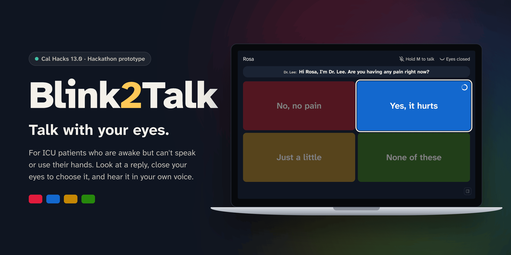
</p>

<p align="center">
  <b>An eye-controlled communication aid for ICU patients who are awake but can't speak or use their hands.</b><br>
  Someone talks, Claude suggests short replies, and the patient answers by looking at one and closing their eyes.
</p>

<p align="center">
  
  
  
  
  
  
</p>

<p align="center">
  <a href="#see-it-work">Demo</a> ·
  <a href="#how-it-works">How it works</a> ·
  <a href="#design-decisions">Design decisions</a> ·
  <a href="#what-we-measured">Results</a> ·
  <a href="#run-it">Run it</a> ·
  <a href="#team">Team</a>
</p>

> [!IMPORTANT]
> Blink2Talk is a hackathon prototype built at Cal Hacks 13.0. It is not a medical device, and it has not been used with patients. Only the team has tested it.

## Why

A patient on a ventilator can be awake and alert but unable to speak. When their hands are too weak or restrained to write or point, conversation shrinks to yes-or-no questions and letter boards. Blink2Talk gives that patient full, natural replies using only their eyes and a laptop webcam, and speaks each reply in their own voice.

## See it work

<p align="center">
  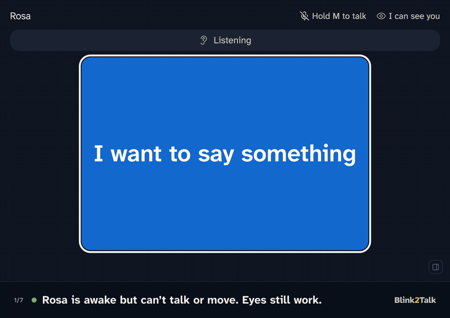
</p>

<sub>Recorded from the real app, with live replies and summaries from Claude. For a clean recording, the eye input came from the app's test hooks, which send the same events as the camera tracker, instead of from a webcam.</sub>

## How it works

<table>
  <tr>
    <td width="50%">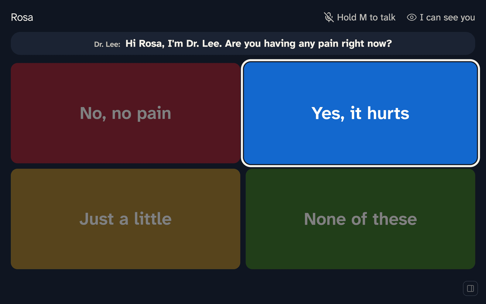</td>
    <td width="50%"></td>
  </tr>
  <tr>
    <td valign="top"><b>1. Someone asks.</b> A nurse holds <kbd>M</kbd> and talks. The question appears as a live caption, labeled with who said it, and Claude suggests three short first-person replies. The fourth box is always <i>None of these</i>.</td>
    <td valign="top"><b>2. The patient looks, then closes their eyes.</b> Looking at a box for 300 ms highlights it. Closing the eyes, or squinting, for 800 ms chooses it. A ring fills during the hold, and opening early cancels.</td>
  </tr>
  <tr>
    <td width="50%">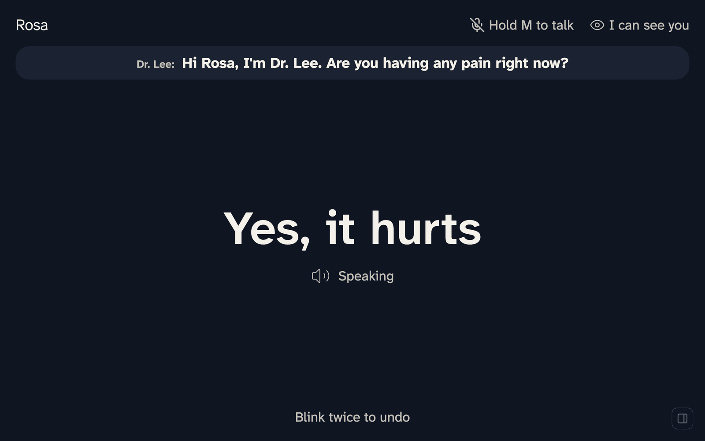</td>
    <td width="50%">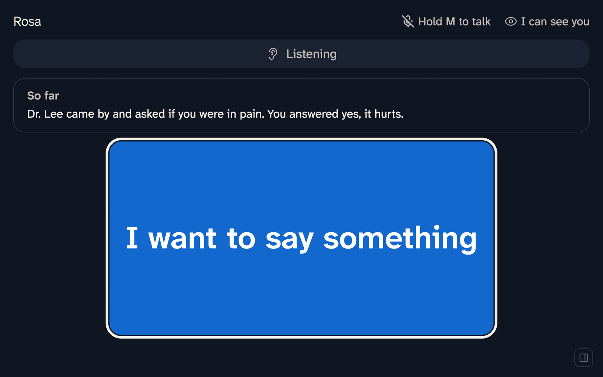</td>
  </tr>
  <tr>
    <td valign="top"><b>3. The reply is spoken aloud</b> in the patient's cloned voice. Two quick blinks undo it.</td>
    <td valign="top"><b>4. The screen keeps the patient oriented.</b> A short <i>So far</i> summary recaps the conversation, and <i>I want to say something</i> lets the patient start one.</td>
  </tr>
</table>

### A second check before medical decisions

When a yes or no would make a medical decision, such as consent to a procedure, a medication change, or CPR, the replies are limited to *Yes*, *No*, and *I need more time*. A *Yes* or *No* is read back before it's spoken. The read-back uses only left and right, the direction the eye tracker reads best.

<table>
  <tr>
    <td width="50%">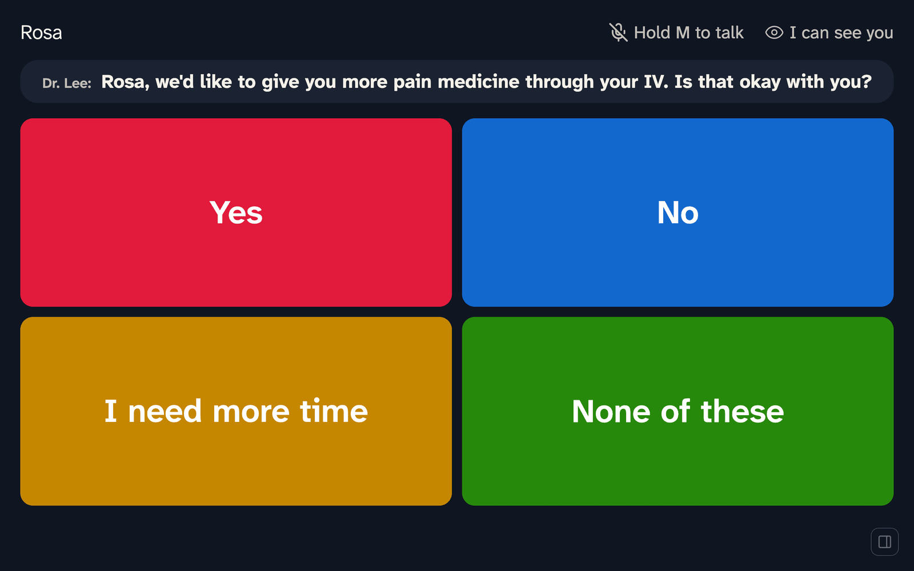</td>
    <td width="50%">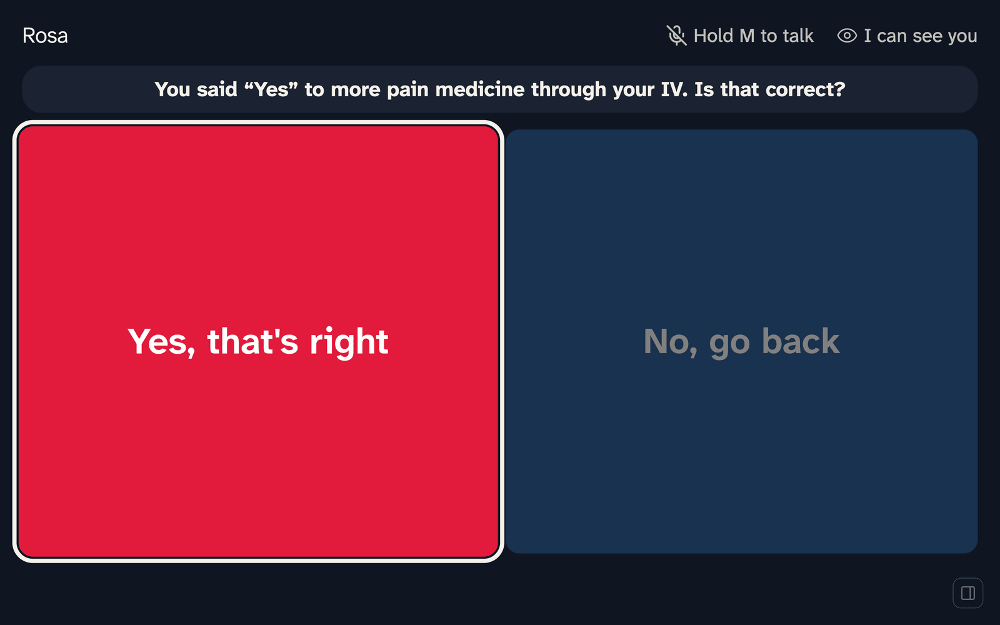</td>
  </tr>
</table>

### Never stuck with the wrong answers

*None of these* asks Claude again on the same question, twice, and never repeats a reply the patient already passed over. The third time opens fixed urgent phrases and a speller. In *Spell it*, each look narrows the letters: E, T, A, and O take two looks and every other letter takes three, with suggested words in the corner.

<table>
  <tr>
    <td width="50%">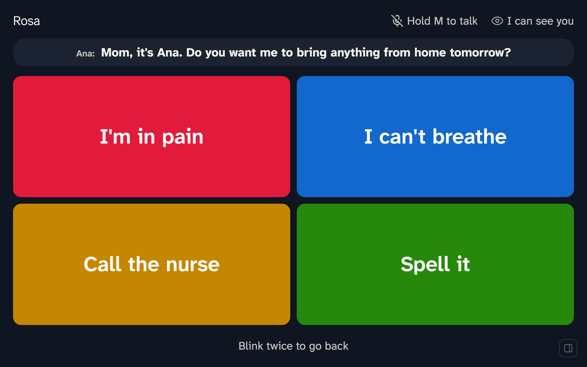</td>
    <td width="50%">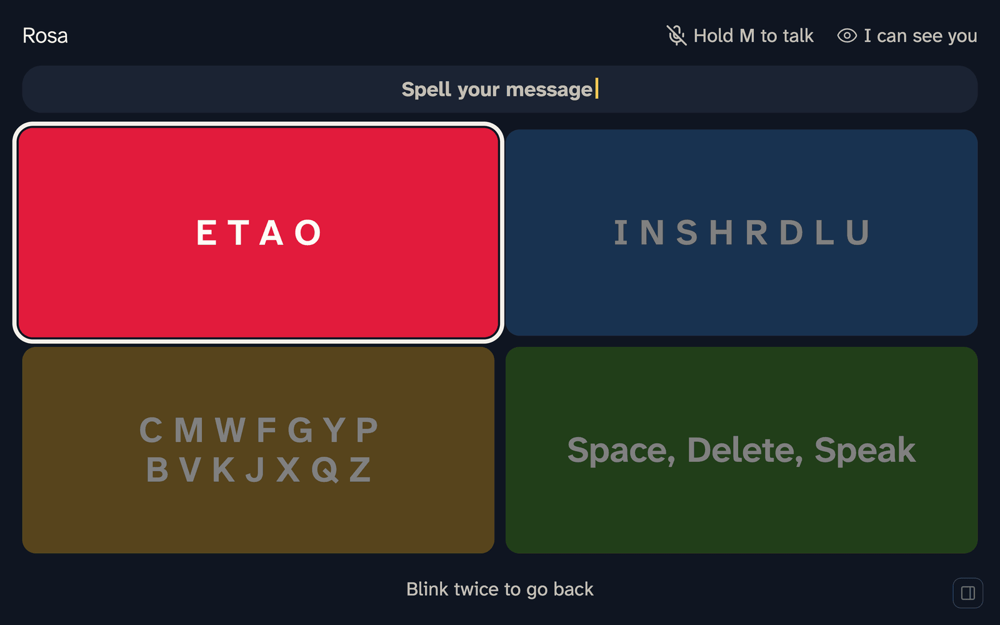</td>
  </tr>
</table>

### The patient can start the conversation

*I want to say something* opens four choices: *I need something*, *I want to ask or say*, *Emergency*, and *I'm in pain*. Phrases the patient picked before come first. *Emergency* says "I need help now" out loud and alerts the care team.

<table>
  <tr>
    <td width="50%">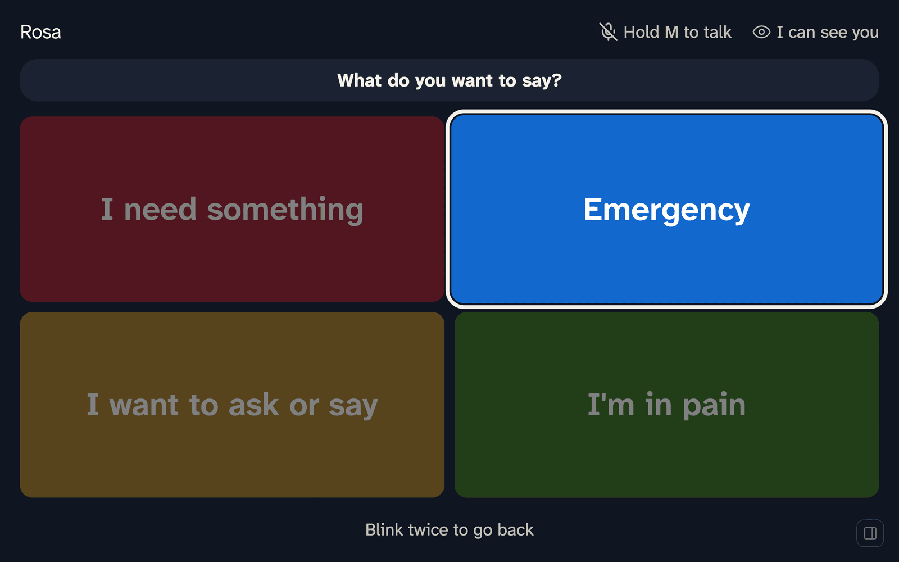</td>
    <td width="50%">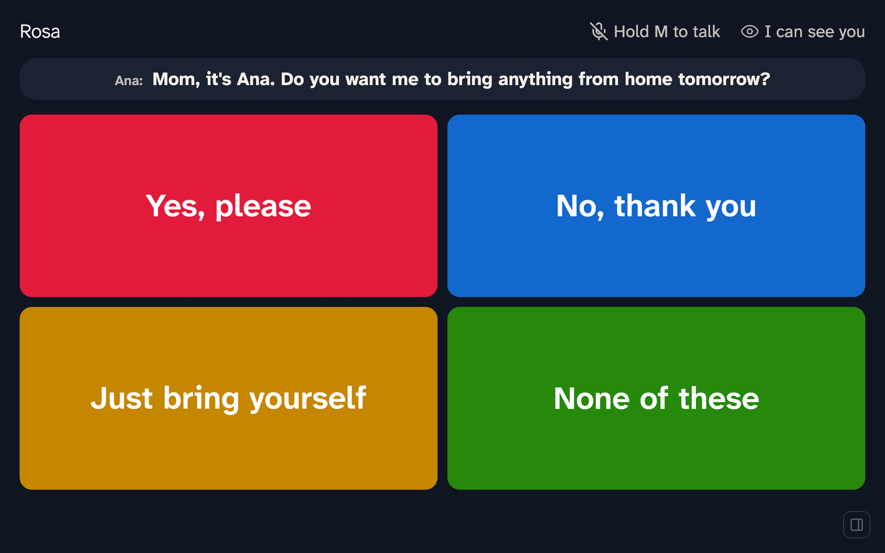</td>
  </tr>
</table>

### A care panel for nurses and family

A side panel shows urgent alerts, with a sound and a desktop notification, a running summary that lists anything still unanswered, and the full conversation with every line labeled by speaker. On-device speaker recognition tells voices apart, and Claude names each voice from what it says.

<p align="center">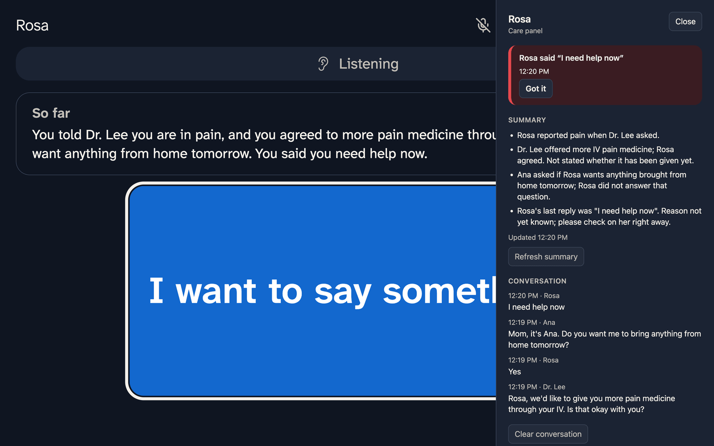</p>

### Easier on tired eyes

Tired mode shows two replies with larger text. It turns on from the care panel, or by itself when the tracker sees signs of fatigue such as a rising blink rate. A light theme is one key away.

<table>
  <tr>
    <td width="50%">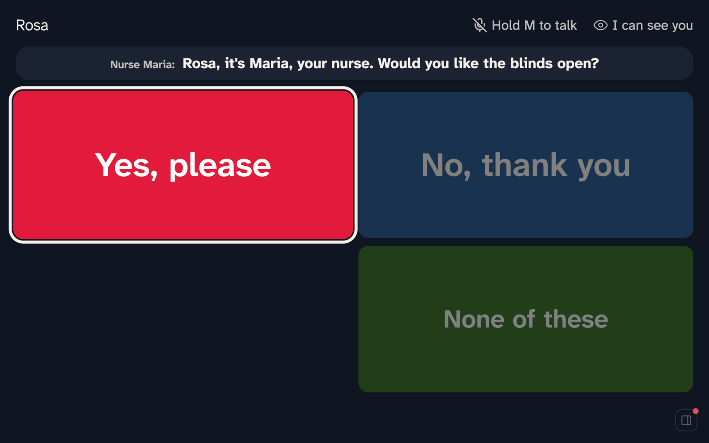</td>
    <td width="50%">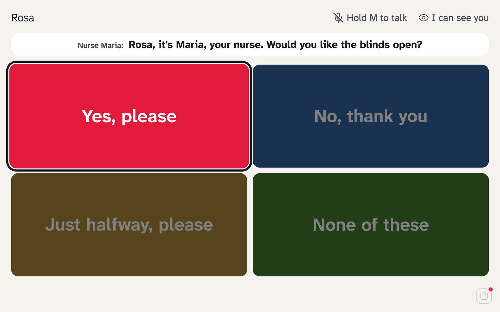</td>
  </tr>
</table>

## Design decisions

- **Eyes are the only input.** We cut head-movement input because most target patients can't move their head reliably: breathing tubes, sedation, neck collars, and ALS neck weakness all get in the way.
- **Four big boxes, four colors.** The boxes sit as far apart as the screen allows, and each has its own color, so a nurse can say "the blue one." We also tested a row of four tall boxes that needed only left-right eye movement, and went back to the 2×2 grid because it tested better.
- **A deliberate hold, not a blink.** Natural blinks are short, so choosing takes 800 ms with the eyes closed. Three seconds closed rests the screen instead, and a 1.2 s pause after each choice stops double picks. Each choice costs the patient about 2.3 s, so every box on screen has to earn its place.
- **Calibrated at every launch.** Lighting, posture, and the laptop's position change between sessions. Calibration takes about 15 s: look at the center dot, then each corner, then squint. Three quick blinks run it again.
- **Fixed text where it matters.** Urgent phrases and the consent read-back are never written by the model. On the Start screen, Claude only reorders known phrases. Replies are told never to invent symptoms or people.
- **Private by default.** Camera frames and voice prints never leave the laptop. Patient notes and history live in one local file.

## Architecture

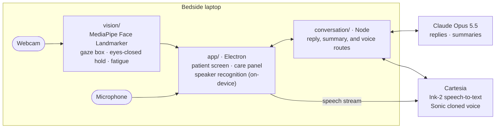

| Folder | What it holds |
|---|---|
| [`app/`](app/) | Electron patient screen, care panel, eye-input adapter, speaker recognition (NVIDIA TitaNet through sherpa-onnx) |
| [`conversation/`](conversation/) | Local server: Claude replies and summaries, Cartesia speech-to-text and cloned voice, the reply eval |
| [`vision/`](vision/) | MediaPipe eye tracking: calibration, gaze boxes, blink and squint holds, rest, fatigue |
| [`bedside/`](bedside/) | Experiment, not used by the app: an offline reply engine that classifies the question and fills fixed templates |
| [`relay/`](relay/) | Team tooling: lets each teammate's coding agent claim files before editing |
| [`context/`](context/), [`docs/`](docs/) | Team context docs, decisions, worklog, consent note, accuracy log |

[`CLAUDE.md`](CLAUDE.md) is the team contract: interfaces, the state machine, what was cut, and a dated decisions log.

## What we measured

### Reply quality and speed

`npm run eval:replies` in `conversation/` scores reply sets on 71 labeled nurse phrases: 37 used while tuning the prompt, and 34 written afterward and never used to change it. Claude Opus grades each set from 1 to 5, and rule checks catch problems such as a missing "no" option on a yes-or-no question.

| | Haiku, first prompt | Opus 5.5 fast mode, rewritten prompt |
|---|---|---|
| Grade, 37 tuning phrases | 3.81 | **4.51** |
| Grade, 34 held-out phrases | 3.76 | **4.38** |
| Held-out sets that broke a rule | 4 | **0** |
| Median time to replies, held-out | 1.53 s | **1.16 s** |

The grader is Opus, the same model that writes the new replies, so treat the grades as a rough guide. Details are in [`context/conversation.md`](context/conversation.md).

### Tests

- `app/`: 20 unit tests and 84 end-to-end checks that drive the real page with injected camera events (`npm test`), plus a randomized stress test (`npm run stress`).
- `vision/`: 54 unit tests (`npm test`).

None of these measure real-camera accuracy.

### Eye tracking

No accuracy test with people outside the team has been recorded yet. Every calibration is logged and checked for fit; the log below updates on its own.

<details>
<summary>Calibration and accuracy log</summary>

<!-- accuracy:start: written by app/accuracy.js after every calibration and accuracy test; edits here are overwritten -->
**Accuracy test: none recorded yet.**

**Calibrations (59 recorded, newest first).** How well each calibration's own looks sort back into the right box. This checks the fit, not accuracy: under 70% (bold) on any box means calibrate again. It sorts into the 2x2 boxes (the default layout).

| When | Tester | Center | Top left | Top right | Bottom left | Bottom right | Notes |
|---|---|---|---|---|---|---|---|
| Oct 25, 11:49 AM PDT | — | 83% | 100% | 100% | 100% | 100% |  |
| Oct 25, 11:48 AM PDT | — | **59%** | 100% | 100% | 100% | 100% | hard to tell apart: center |
| Oct 25, 11:46 AM PDT | — | 83% | 96% | 100% | 100% | 100% |  |
| Oct 25, 11:45 AM PDT | — | **0%** | **26%** | 71% | 100% | **2%** | hard to tell apart: center, top left, bottom right; squint not found, full blinks select |
| Oct 25, 10:52 AM PDT | — | **6%** | **47%** | 98% | 100% | 100% | hard to tell apart: center, top left |

Updated automatically after every calibration and accuracy test. Full history: [docs/accuracy.md](docs/accuracy.md).
<!-- accuracy:end -->

To add a result: open Dev mode (backtick), type who's testing (a first name or "Guest 1"; it goes into the repo), recalibrate, then run **Accuracy test (8 looks)**. It tests the layout chosen in Dev mode; the 2×2 grid is the default. After pulling teammates' results, run `npm run accuracy` in `app/`.

</details>

## Run it

You need a Mac with a webcam (built and tested on macOS with Apple silicon), Node.js 22.9 or later, and API keys for Anthropic and Cartesia.

```sh
cp conversation/.env.example conversation/.env   # add ANTHROPIC_API_KEY, CARTESIA_API_KEY, CARTESIA_VOICE_ID
./start                                          # installs what's missing, then opens the app full screen
```

The first run downloads Electron, the MediaPipe face model, and a speaker-recognition model (about 100 MB), and macOS asks for camera and microphone access. Calibration starts right away: look at each dot, then squint. Without keys, the app still runs with sample replies and the system voice.

To try it without a patient, use the keyboard: arrow keys move the highlight, holding <kbd>Space</kbd> for a second chooses, and <kbd>D</kbd> opens demo controls with sample questions. [`app/README.md`](app/README.md) lists every key.

## How we built it

Three people built Blink2Talk over one weekend, each working with a coding agent. A small relay server ([`relay/`](relay/)) had every agent claim files before editing and blocked edits to files another agent held, so several agents could work in one repository at once without overwriting each other. Shared interfaces and every scope cut are recorded in [`CLAUDE.md`](CLAUDE.md), and each owner keeps a context file in [`context/`](context/).

## Known limitations

- Not a medical device, and not tested with patients. Tested only by the team.
- Needs the patient to hold their gaze; there's no fallback for nystagmus or a swollen eye. Blink and squint thresholds aren't validated across eye shapes.
- Needs a network connection for replies, captions, and the voice. Slow Wi-Fi makes replies slow; after a timeout, the app falls back to safe fixed replies.
- No free text beyond the speller.
- Speaker recognition was tuned on synthetic voices.

## Privacy

See [`docs/consent.md`](docs/consent.md) for what is recorded, where it goes, and what to ask before using the app with someone.

## Team

| | Owned |
|---|---|
| **Noel Sason** | Patient app (`app/`): patient screen, care panel, eye-input adapter, speaker recognition; design |
| **Marco Lanza** | Product decisions and layout testing; team docs and submission (`context/`, `docs/`) |
| **Samarth Mathur** | Conversation server (`conversation/`): Claude replies and summaries, Cartesia speech-to-text and cloned voice |

Julian was a registered member of our team but had to leave because of a serious illness the night before the demo.

Built at [Cal Hacks 13.0](https://calhacks.io).
